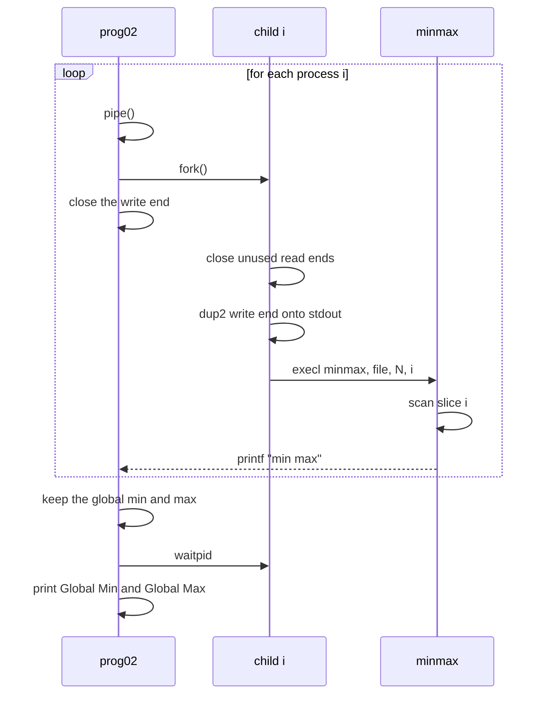

# Parallel min/max

`prog02` finds the minimum and maximum 32-bit integer in a binary file by splitting the file across child processes. Each child is replaced by `minmax`, which reads one slice and prints that slice's minimum and maximum. The parent reads those results through pipes and prints the overall minimum and maximum.

This started as a CS 3100 (Operating Systems) assignment at Weber State University in early 2025. Chance Brenchley wrote the original `prog02` and `minmax` programs. The fork, pipe, and exec structure here is that assignment. The changes on top of it are the ones needed to compile cleanly, reap children, find the `minmax` binary, and test the result.

## What it does

```text
./build/prog02 <numOfProcesses> <filename>
```

The file is a raw sequence of `int` values in host byte order. `prog02` creates one pipe per process and forks one child. The child closes the pipe ends it will not write, points standard output at the pipe with `dup2`, and calls `execl` on `minmax`.

`minmax` is also a standalone program:

```text
./build/minmax <filename> <numOfProcesses> <processNum>
```

It divides the file by integer count:

```text
sectionSize = numInts / numOfProcesses
process i reads [i * sectionSize, i * sectionSize + sectionSize - 1]
```

The last process sets its end index to `numInts - 1`, so a remainder stays with the last slice. When there are more processes than integers, `sectionSize` is 0. Every process except the last one sees an empty range and leaves its minimum at `INT_MAX` and its maximum at `INT_MIN`. The last process reads the whole file. The parent starts from those same sentinels, so an empty slice does not move the global result.

`prog02` looks up `minmax` next to its own binary (`/proc/self/exe`). `make` places both executables in `build/`, so `./build/prog02` works from any working directory. If that lookup fails, it tries `./minmax` in the current directory.

## Process flow



After `fork`, the parent and the child run at the same time. The diagram lists the parent's `close` first. The child still has its own copy of the write end, and that copy becomes standard output.

## Operating systems concepts

- **Process creation.** `fork` duplicates the parent. The child branch is `pid == 0`. The parent stores each child pid.
- **Pipes.** Each child has a private pipe. The parent keeps the read end and closes the write end. The child does the opposite, and also closes read ends it inherited from earlier pipes.
- **Redirect and exec.** `dup2` makes `printf` in the worker write to the pipe. `execl` replaces the child image with `minmax`. The pipe survives exec because it is open on standard output.
- **Splitting the work.** Slices are contiguous index ranges. The last slice absorbs the remainder when the count does not divide evenly.
- **Waiting.** After the pipes have been read, the parent calls `waitpid` for every child and reaps it. A non-zero exit status fails the parent.

## Build

Requires GCC and make. The test also uses Python 3. The path lookup uses `/proc/self/exe`, so build and run this on Linux.

```sh
make
```

That is the same as:

```sh
mkdir -p build
gcc -Wall -Wextra -std=c11 -o build/prog02 src/prog02.c
gcc -Wall -Wextra -std=c11 -o build/minmax src/minmax.c
gcc -Wall -Wextra -std=c11 -o build/gen_data tools/gen_data.c
```

`make clean` removes `build/`.

## Run

`gen_data` writes `count` random `int`s. The optional seed makes the file repeatable.

```sh
./build/gen_data 1000 input.bin 3100
./build/prog02 4 input.bin
```

```text
Global Min: -2145054400
Global Max: 2147342200
```

The four slices of that same file are equal length (1000 / 4). Run on their own:

```text
$ ./build/minmax input.bin 4 0
-2121436054 2147342200
$ ./build/minmax input.bin 4 1
-2125364173 2121341556
$ ./build/minmax input.bin 4 2
-2028147152 2094572097
$ ./build/minmax input.bin 4 3
-2145054400 2134150098
```

The parent result is the smallest of those minimums and the largest of those maximums.

`input.bin` is a generated data file. `*.bin` is listed in `.gitignore`.

## Test

```sh
make test
```

The script builds the three programs, generates files, and checks `prog02` against both of these:

- `minmax` run as one process over the whole file
- a separate Python scan of the same bytes

The counts cover a single process, uneven splits (3, 7, and 15 processes on 1000 integers; 6 processes on 7 integers), and more processes than integers (11 and 17 on 10 integers; 8 and 20 on 7 integers, including `INT_MIN` and `INT_MAX` in the file). One `prog02` run uses `/` as its working directory, so the worker path has to come from the executable's own directory.

GitHub Actions runs `make test` on `ubuntu-latest` for pull requests and for pushes to `main`.

## Layout

| Path | Role |
| --- | --- |
| `src/prog02.c` | Parent. Forks, execs, reads pipes, prints the global min and max. |
| `src/minmax.c` | Worker. Reads one slice and prints `min max`. |
| `tools/gen_data.c` | Writes random integers to a binary file. |
| `tests/test_minmax.sh` | Compares parallel runs with a single-process result. |
| `Makefile` | `all`, `test`, and `clean`. |

## Limits

The file is host-endian `int` values. A trailing partial integer is ignored. An empty file never updates the sentinels, so the parent prints `INT_MAX` and `INT_MIN`.

The parent keeps one pipe read end per child, and the pipe table lives on the stack, so very large process counts are limited by open files and stack size. The assignment runs are small counts on a local file.
